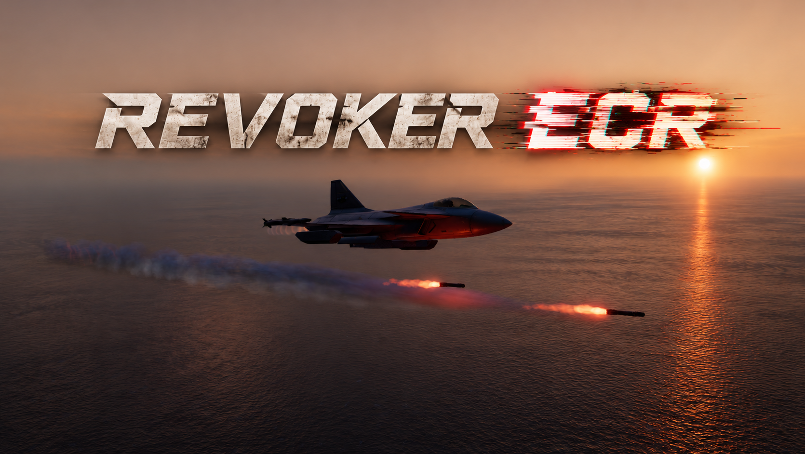
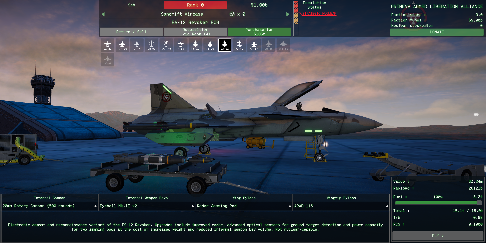

# EA-12 Revoker ECR

The EA-12 is a modification of the standard FS-12 specializing in electronic warfare and reconnaissance available as a new rank 4 aircraft.

The Revoker ECR's defining features are access to jammer pods and improved sensors.

## Onboard systems

| | **EA-12 Revoker ECR** | FS-12 Revoker | KR-67 Ifrit | EW-25 Medusa | SFB-81 Darkreach |
|---|---|---|---|---|---|
| **Radar** | **50km/27NM** **Clutter Factor 0.12** | 40km/21.6NM Clutter Factor 0.2 | 50km/27NM Clutter Factor 0.12 | 100km/54NM Clutter Factor 0.05 | 50km/27NM Clutter Factor 0.3 |
| **Optical** | **16km/8.6NM** **Magnification ×2** | 10km/5.4NM Magnification ×0.7 | 10km/5.4NM Magnification ×1 | 10km/5.4NM Magnification ×1 | 12km/6.5NM Magnification ×2 |
| **Capacitor** | **750kJ** | 500kJ | 500kJ | 1170kJ | 500kJ |
| **EW Pods** | **2** | 0 | 0 | 4 | 0 |
| **Laser Designators** | **2** | 1 | 1 | 0 | 0 |
| **IR Flares** | **x86** | x64 | x72 | x86 | x86 |
| **RCS** | **0.08** | 0.08 | 0.0015 | 0.056 | 0.01 |
| **Price** | **$105.0m** **Rank 4** | $65.0m Rank 3 | $126.0m Rank 4 | $145.0m Rank 4 | $225.0m Rank 5 |

## Revoker ECR pylon loadout highlights

- two radar jamming pods
- up to six anti radiation missiles
- internal storage for the AGM-48 series, including the Eyeball mk2.
- triple pods for the AGR-24 Kingpin laser guided rocket alongside two laser designators to saturate enemy defenses

The Revoker ECR's improved sensors and added EW equipment result in a weight increase and smaller internal weapon bays. This keeps the vanilla FS-12 relevant for air to air missions while the EA-12 excels in a support and SEAD role.

Every hangar that offers the FS-12 also offers the EA-12. A mission that restricts the FS-12 restricts the EA-12 too.

The FS-12 itself is left unchanged. The mod builds the EA-12 as a copy when the game starts and checks the FS-12 against it every time; the BepInEx log then says "Vanilla check passed".

## Installation

Install it through NOMM, the Nuclear Option Mod Manager. Without NOMM, download the zip from the [releases](https://github.com/GeraldHofbauerWeb/NO-RevokerECR/releases) page and put `NORevokerECR.dll` into `Nuclear Option/BepInEx/plugins/`. Both ways need BepInEx 5.

## Multiplayer

Every player in a session needs the same version of this mod and the same other aircraft and weapon mods. The mod adds its tag to the game version (for example `0.34.6_NO-RevokerECR-v1.0.0`), so the lobby list only shows lobbies with exactly the same mods, and joining any other lobby fails with "Incorrect version". To play in public lobbies without the mod, switch it off in NOMM. A dedicated server needs the mod as well, in the same version as the players, or they will not see it in the server list.

## If something is wrong

Turn on `DebugDump` for NO-RevokerECR in the game's config menu (F1), or set `DebugDump = true` in `BepInEx/config/xyz.geraldhofbauer.norevokerecr.cfg`. Restart the game and attach `BepInEx/LogOutput.log` to an issue.

## Building

`scripts/make-refs.sh` creates reference assemblies from your installed game in `lib/refs/`. They are not in the repository because they come from the game's own code. `scripts/build.sh` then builds the plugin and runs the tests in a .NET SDK container.

## Credits

Seb designed the EA-12 and its values, tested it in game, wrote the description and took the screenshots.

## License

MIT, see [LICENSE](LICENSE).
